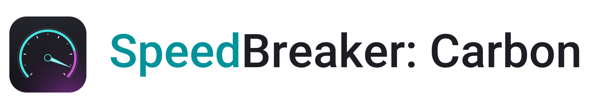
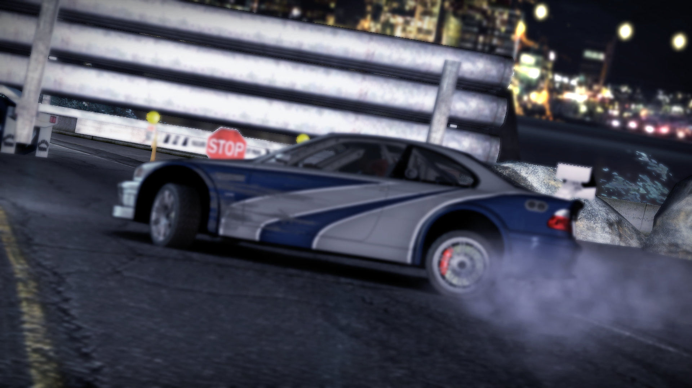
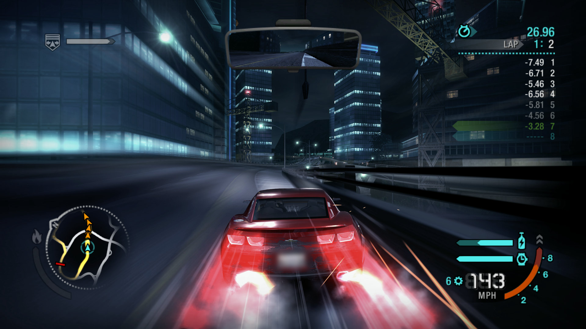
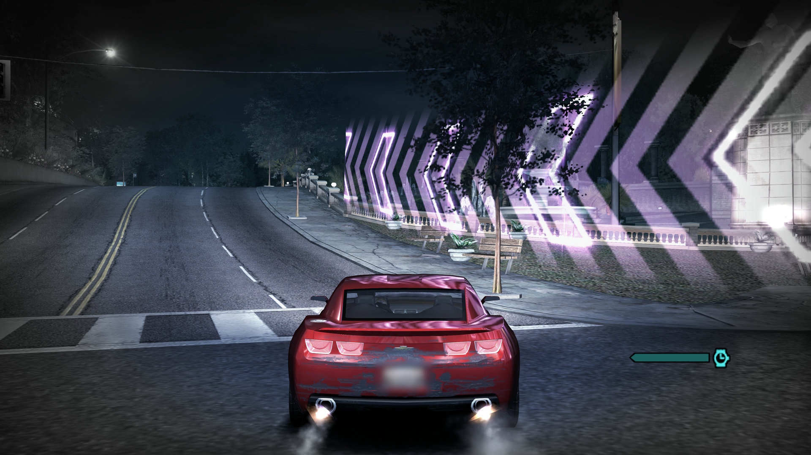
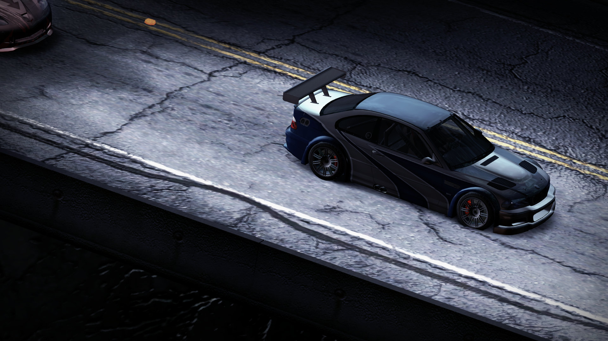
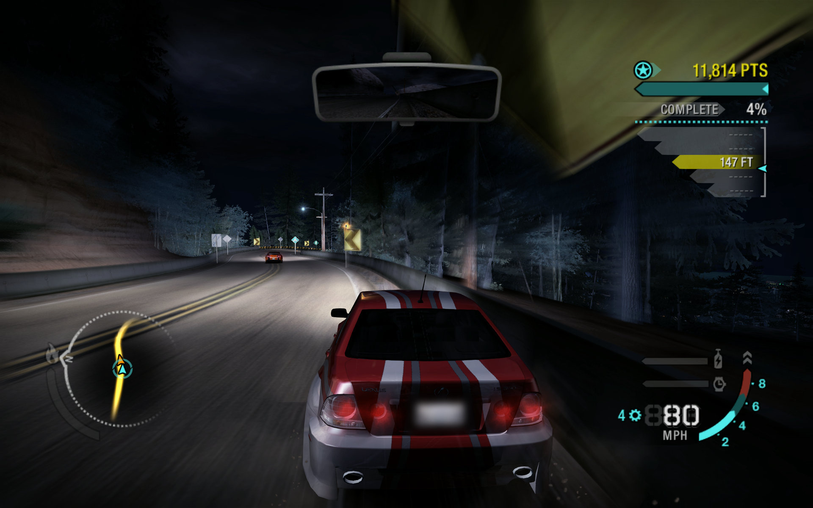
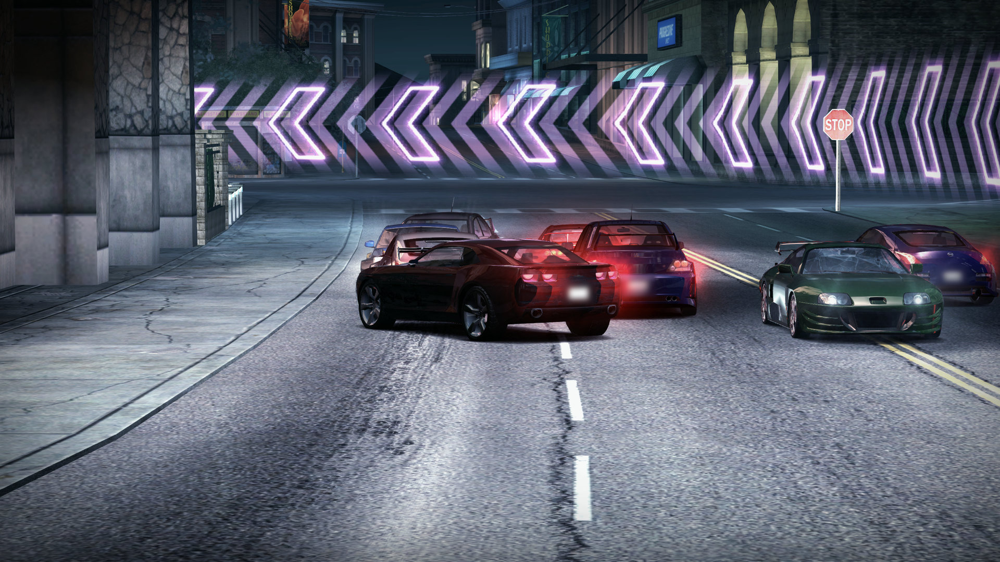
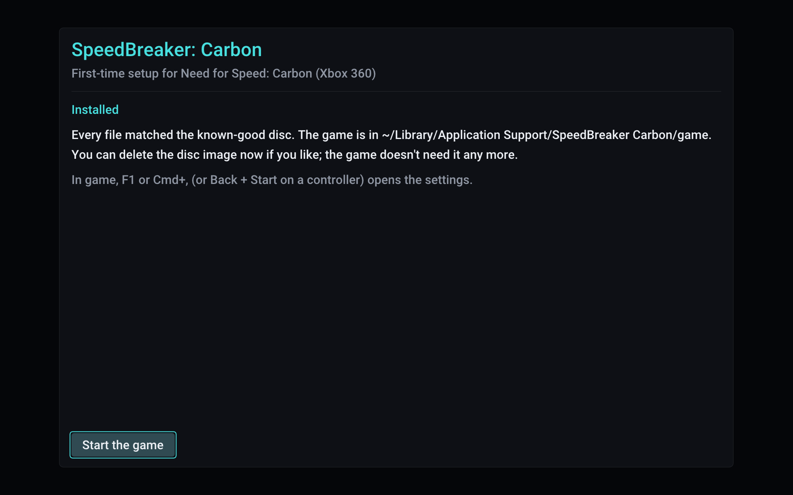

<p align="center">
  <picture>
    <source media="(prefers-color-scheme: dark)" srcset="assets/speedbreaker-carbon-banner-dark.png">
    
  </picture>
</p>

<p align="center">
  <b>An unofficial static recompilation of the Xbox 360 version of <i>Need for Speed: Carbon</i> (2006):<br>
  a native port, not an emulator.<br>
  Play your own copy on Steam Deck, Steam Machine and Steam Frame (SteamOS), Linux and Mac.</b>
</p>

<p align="center">
  <a href="https://github.com/SpeedBreakerProject/speedbreaker-carbon/releases/latest"><b>Download</b></a>
  &nbsp;·&nbsp;
  <a href="#quick-start">Quick start</a>
  &nbsp;·&nbsp;
  <a href="https://projectugarte.com/speedbreaker/">Website</a>
  &nbsp;·&nbsp;
  <a href="#reporting-a-bug">Report a bug</a>
  &nbsp;·&nbsp;
  <a href="https://github.com/SpeedBreakerProject/speedbreaker">SpeedBreaker for Most Wanted</a>
</p>

<p align="center">
  
  <br>
  <sub>The prologue: the M3 GTR at the edge of Palmont, rendered at 2560x1440.</sub>
</p>

> [!IMPORTANT]
> **SpeedBreaker: Carbon is an unofficial fan project by project(u). It is not affiliated with,
> endorsed by or sponsored by Electronic Arts Inc., the Need for Speed brand or Valve
> Corporation.**
>
> **No game files are included or distributed.** To play, you need your own legally obtained
> backup (a disc image) of your own Xbox 360 disc of *Need for Speed: Carbon* (2006), the **USA
> Collector's Edition**. The in-app installer verifies it and installs it. Please don't ask for,
> or share, game files or disc images. See the full [legal notice](#legal-notice).

**Contents:** [What it is](#what-is-speedbreaker-carbon) · [Highlights](#highlights) ·
[Download](#download) · [Quick start](#quick-start) · [Which copy do I need?](#which-copy-do-i-need) ·
[How to update](#how-to-update) ·
[Setup by platform](#setup-by-platform) · [Portable mode](#portable-mode) ·
[Controls](#controls) · [Settings](#settings) · [Tips](#tips-for-smooth-play) ·
[FAQ](#faq-and-troubleshooting) · [Known issues](#known-issues) · [What's next](#whats-next) ·
[For developers](#for-developers) · [Credits](#credits) · [License](#license) ·
[Legal notice](#legal-notice)

## What is SpeedBreaker: Carbon?

SpeedBreaker: Carbon is an unofficial static recompilation of the Xbox 360 version of *Need for
Speed: Carbon* (2006): a native port, not an emulator. It runs as an ordinary app on your device
(see [how it works](#how-it-works)). It came out on October 29, 2026, for the game's 20th anniversary on October 31.

It is the second game on **SpeedBreaker**'s engine. [SpeedBreaker](https://github.com/SpeedBreakerProject/speedbreaker)
does the same for *Need for Speed: Most Wanted* (2005); the two are separate apps, with their own
downloads, saves and settings, and you can install both side by side.

It is built from the **Xbox 360 version** of the game, not the PC version: it runs the Xbox 360
release's own code, translated ahead of time, and it installs only from the Xbox 360 disc of the
**USA Collector's Edition**.

You bring the game: SpeedBreaker: Carbon installs it from a backup of your own disc and checks
every file. Then you race through Palmont, with things the Xbox 360 couldn't do: sharper than
720p, ultrawide and tall screens, and a settings menu you can open mid-race.

## Highlights

- **Sharper than the console.** The 3D scene renders above the Xbox 360's 720p. *Auto* picks a
  scale from your screen and your graphics chip.
- **Any screen shape.** On 21:9 screens the view gets wider instead of stretched. The 16:10
  screens of the Steam Deck and many Macs, and other taller screens, show more above and below
  and fill the screen at their own resolution: a Steam Deck renders 1280x800, pixel for pixel.
- **A steady 60 fps,** locked to your 60 Hz display, with the game's movies paced as on the
  console.
- **As on the 360:** the nitrous light trails at the console's length, and the picture a real
  Xbox 360 sends to a TV (the game's own display gamma), so the game's own Brightness slider
  works. Anti-aliasing, sharpening, FSR 1 upscaling, a Brightness setting and up to 16x
  anisotropic filtering are also available.
- **A guided installer.** It finds your disc image, checks that it is the right game and edition,
  and verifies all 78 files as it copies them. An interrupted install never leaves a broken game.
- **Your controller, or the keyboard.** Controllers work as an Xbox 360 pad, with hot-plugging
  and rumble. Every keyboard control can be reassigned in the settings.
- **A settings menu that pauses the game.** Open it with F1 or Back + Start. Every change applies
  at once, and *Quit Game* leaves the game from a controller too.
- **One-button bug reports.** Logs, settings and a screenshot go into one zip file. Nothing is
  uploaded, and you decide what to send.
- **Check for Updates.** One press in the settings asks GitHub whether a newer release is out,
  shows what changed and opens the download page (or shows it as a QR code for your phone).
  Nothing is checked online unless you press Check for Updates.

<table>
  <tr>
    <td width="50%"><br><sub>Nitrous at 143 mph: the light trails at the console's length.</sub></td>
    <td width="50%"><br><sub>Speedbreaker: slow motion past the neon chevrons, at 3840x2160.</sub></td>
  </tr>
  <tr>
    <td width="50%"><br><sub>The prologue's canyon road, from above.</sub></td>
    <td width="50%"><br><sub>16:10, the Steam Deck's shape: a Canyon Duel.</sub></td>
  </tr>
  <tr>
    <td width="50%"><br><sub>The finish at the neon chevrons.</sub></td>
    <td width="50%"><br><sub>First run: every file matched the known-good disc.</sub></td>
  </tr>
</table>

<sub>Screenshots: SpeedBreaker: Carbon v0.1.0 on a MacBook Pro (M1 Pro). They are unedited frames
from the game's own output, except that the licence plates in the nitrous, Speedbreaker, Canyon
Duel and finish images are blurred. The game content in them belongs to its owners.</sub>

## Download

| Platform | How to get it | Tested on |
|---|---|---|
| **Steam Deck** and **Steam Machine** (SteamOS) | [Download][dl-steamos-x86_64]<br>`SpeedBreaker-Carbon-steamos-x86_64.tar.xz` | Steam Machine (SteamOS 3.8) on a 3440x1440 ultrawide, and a Steam Deck. |
| **Steam Frame** (SteamOS, arm64) | [Download][dl-steamos-arm64]<br>`SpeedBreaker-Carbon-steamos-arm64.tar.xz` | Steam Frame. It plays as a big flat screen in the headset; it is not a VR mode. |
| **Linux** (x86-64) | [Download][dl-steamos-x86_64] the x86-64 SteamOS build, `SpeedBreaker-Carbon-steamos-x86_64.tar.xz`, or [build from source](#building-from-source) | Tested here on SteamOS. Other distributions: reports welcome. |
| **Mac** (Apple silicon) | [Download][dl-macos]<br>`SpeedBreaker-Carbon-macos.dmg` | MacBook Pro (M1 Pro) on macOS 27. There is no Intel Mac build. |
| **Windows** (beta) | [Download][all-releases] `SpeedBreaker-Carbon-0.1.0-windows-x64-beta.zip` from its own pre-release on the Releases page; see [Windows (beta)](#windows-beta) | A ThinkPad laptop with Intel integrated graphics (UHD Graphics, 60 Hz). SpeedBreaker for Most Wanted's Windows testers report NVIDIA and AMD graphics running fine; Intel Arc graphics and 120/144 Hz monitors haven't been tested yet: [reports welcome](#reporting-a-bug). |
| **iPhone** and **iPad** (experimental) | [Sideload the IPA](#iphone-and-ipad), `SpeedBreaker-Carbon-0.1.0-ios.ipa` on the [release page][releases], or [build it yourself](#iphone-and-ipad) with Xcode | iPhone 18 Pro Max (iOS 27) with a Backbone Pro. Not on the App Store. That was an Xcode-signed build: the IPA itself hasn't been installed on a device yet. |

Each link downloads the newest release. Every file and its `.sha256` checksum file are on the
[latest release page][releases]. To check a download, put its `.sha256` file next to it and run
`shasum -a 256 -c SpeedBreaker-Carbon-macos.dmg.sha256` on a Mac, or
`sha256sum -c SpeedBreaker-Carbon-steamos-x86_64.tar.xz.sha256` on SteamOS (with your file's
name): it should say OK. What changed in each release is in [CHANGELOG.md](CHANGELOG.md).

### System requirements

- **Everyone:** a disc image of your own **Xbox 360 disc of the USA Collector's Edition** (see
  [Quick start](#quick-start)), about **6 GB** of free space, and a display running at about
  **60 Hz**.
- **Steam Deck, Steam Machine and Linux PCs** (the x86-64 SteamOS download): a 64-bit x86 CPU
  with AVX2 (x86-64-v3): Intel Haswell (2013) or newer, or AMD Excavator, Zen or newer. A
  Vulkan 1.2 graphics card.
- **Steam Frame** (the arm64 SteamOS download): SteamOS on the Steam Frame, kept up to date. The
  arm64 download is for the Frame only; it hasn't been tested on any other arm64 Linux device.
- **Windows (beta):** Windows 10 or 11, 64-bit; a CPU with AVX2 (Intel Haswell from 2013 or
  newer, or any AMD Ryzen; without it the game says so and closes); a Vulkan 1.2 graphics card
  with a current driver.
- **Mac:** Apple silicon and **macOS 15** (Sequoia) or later. The app won't open on older
  versions of macOS, and there is no Intel Mac build.
- **iPhone and iPad** (experimental): iOS or iPadOS 17 or later, on an A15-class chip or newer
  (iPhone 13 and later, M-series iPads), and a controller or keyboard. So far only an iPhone 18
  Pro Max has run it; other devices are untested.

## Quick start

1. **Back up your own disc.** SpeedBreaker: Carbon supports one version of the game: the **USA
   Collector's Edition** for Xbox 360 (see [Which copy do I need?](#which-copy-do-i-need)). The
   standard edition and other regions aren't supported yet. The installer takes a full `.iso`, a trimmed XISO, or a folder with the extracted disc
   files. No title update is needed. SpeedBreaker: Carbon doesn't provide game files or disc
   images, or link to them.
2. **Get SpeedBreaker: Carbon.** [Download it](#download) for Steam Deck, Steam Machine and
   Steam Frame (SteamOS), Linux, Mac or Windows (beta). On iPhone and iPad you sideload the
   experimental IPA or build it yourself. Then follow the [setup for your platform](#setup-by-platform).
3. **Start it and install.** On first run, SpeedBreaker: Carbon looks for your disc image, checks
   that it is the right game and edition, then copies and verifies every file. This takes a few
   minutes at most. Afterwards you can delete the disc image.
4. **Race.** Your saves and settings are kept apart from the game, so they stay when you
   [update](#how-to-update) or reinstall the game. The settings open with **F1** or
   **Back + Start** on a controller.

### Which copy do I need?

The **USA Collector's Edition** of *Need for Speed: Carbon* for Xbox 360.

- **How to tell:** its case and cover say *Collector's Edition*. Its disc's media ID, which disc
  backup tools show, is `1F8BEB88`.
- **Not supported yet:** the standard edition and other regions. The installer tells you when
  your copy is one of them.
- **The standard edition:** support for it is being considered, and depends on how many players
  want it. Say so on [its tracking issue](https://github.com/SpeedBreakerProject/speedbreaker-carbon/issues/1).

### How to update

- **Mac:** drag the new SpeedBreaker Carbon into Applications, choose **Replace**, then allow it
  once more with **Open Anyway** (see [Mac setup](#mac)).
- **Steam Deck, Steam Machine, Steam Frame and Linux:** unpack the new download over the old
  folder (`~/Games/SpeedBreaker-Carbon`); your Steam shortcut keeps working.
- **Windows (beta):** extract the new zip into a new folder, run it from there, then delete the
  old folder.
- **Everywhere:** your saves, settings and the installed game are kept, and no disc image is
  needed. Settings > Advanced > **Check for Updates** says when there's a new release, and so
  does GitHub's **Watch > Custom > Releases**.

## Setup by platform

### Steam Deck and Steam Machine

1. **Download and unpack** (in Desktop Mode). Download the SteamOS build,
   [`SpeedBreaker-Carbon-steamos-x86_64.tar.xz`][dl-steamos-x86_64]. Make a `Games` folder in
   your home folder, move the file there, and choose *Extract archive here*. Or, in Konsole:

   ```sh
   mkdir -p ~/Games && tar -xf ~/Downloads/SpeedBreaker-Carbon-steamos-x86_64.tar.xz -C ~/Games
   ```

   This makes `~/Games/SpeedBreaker-Carbon`, next to SpeedBreaker's own folder if you have it:
   neither replaces the other. Keep it on internal storage or on an SD card formatted by SteamOS,
   and don't use `:`, `;` or `$` in the folder names.

2. **Add it to Steam.** Steam > Games > *Add a Non-Steam Game to My Library* > Browse. Set the
   file type to *All Files* and pick `~/Games/SpeedBreaker-Carbon/speedbreaker.sh`, the launcher
   (the program itself is in `lib/`), then rename the shortcut in its Properties. Leave
   *Compatibility* (Proton) off: this is a native Linux game.
3. **Put your disc image in Downloads,** or in the top folder of an SD card. SpeedBreaker: Carbon
   also looks in your home folder, Desktop, Documents, Games and USB drives. Game Mode only sees
   SD cards and USB drives formatted by SteamOS; for a card formatted on a PC, copy the image into
   Downloads first.
4. **Install** (back in Game Mode). Start SpeedBreaker: Carbon from your library. It highlights
   the image it found (*Ready to install*; with several, pick yours with Up and Down): press
   **A**, then **A** again on *Install*. Use the images it finds rather than *Browse for
   image...*, which may not open in Game Mode. The game goes to the internal storage; to put it
   on the SD card or in another folder, press Up and pick with Left and Right before *Install*.
   *Choose a folder...* opens a folder picker in Desktop Mode only; from Konsole, the
   [command-line installer](#command-line-installer) takes `--dest <folder>`.
5. **Check the screen settings.**
   - **Steam Deck OLED: set the refresh rate to 60 Hz** (Quick Access > Performance). At 90 Hz
     the game's frames can't be shown evenly, and a note says so, once. Turn on Steam's per-game
     profile there and it keeps 60 Hz for this game. On any Deck, leave the Framerate Limit off.
   - **Docked, or on a Steam Machine:** in the shortcut's Properties > General > Game
     Resolution, choose **Native**.
   - The picture fills the Deck's 16:10 screen, with a slightly taller view. For the console's
     16:9 picture with thin bars above and below, set Settings > Display > Aspect Ratio to 16:9.

**Controls:** the Deck's controls work through Steam Input (default Gamepad layout).
**Settings:** hold **View** (two squares, left of the screen) and press **Menu** (three lines,
right of the screen).

**Uninstall:** delete `~/Games/SpeedBreaker-Carbon/`, `~/.local/share/speedbreaker-carbon/`
(this deletes your saves too) and `~/.cache/speedbreaker-carbon/`, and remove the shortcut from
Steam. SpeedBreaker for Most Wanted's folders are never touched.

### Steam Frame

The Steam Frame has its own download. You set it up on the Frame's desktop: open the
**Desktop** app in your Steam library.

1. **Download and unpack.** Download the Steam Frame build,
   [`SpeedBreaker-Carbon-steamos-arm64.tar.xz`][dl-steamos-arm64], into Downloads (not the
   x86-64 one: that is for the Steam Deck, Steam Machine and Linux PCs). The Frame's file manager
   can't unpack it, so open **Konsole** and run:

   ```sh
   mkdir -p ~/Games && tar -xf ~/Downloads/SpeedBreaker-Carbon-steamos-arm64.tar.xz -C ~/Games
   ```

   This makes `~/Games/SpeedBreaker-Carbon`. Keep it on the Frame's internal storage, and don't
   use `:`, `;` or `$` in the folder names.
2. **Add it to Steam.** In the file manager, open `~/Games/SpeedBreaker-Carbon`, right-click
   `speedbreaker.sh` and choose *Add to Steam*. Or, in Konsole:
   `steamos-add-to-steam ~/Games/SpeedBreaker-Carbon/speedbreaker.sh`. Leave *Compatibility*
   (Proton) off: this is a native Linux game.
3. **Put your disc image in Downloads.** SpeedBreaker: Carbon also looks in your home folder,
   Desktop, Documents and Games.
4. **Install.** Start it from your Steam library. It highlights the image it found (*Ready to
   install*): press **A**, then **A** again on *Install*. Or install from Konsole:
   `~/Games/SpeedBreaker-Carbon/speedbreaker.sh --install ~/Downloads/your-image.iso` (with your
   image's name; add `--dest <folder>` to put the game in a folder of your choice).

It plays as a big flat screen in the headset. It is not a VR mode.

- **Settings:** press **Menu + View** together.
- **Frame rate:** if the picture isn't smooth in the headset, set **Display > Frame Rate** to
  **30 fps**. The VR compositor shares the graphics chip.
- **Uninstall:** as on the [Steam Deck](#steam-deck-and-steam-machine).

### Linux

There's no separate desktop-Linux package yet. Try the x86-64 SteamOS download,
[`SpeedBreaker-Carbon-steamos-x86_64.tar.xz`][dl-steamos-x86_64], which brings its own runtime
libraries and is tested here on SteamOS, or [build from source](#building-from-source). Unpack it,
put your `.iso` in your home folder, Downloads, Desktop, Documents or Games (or on a USB drive),
and run `speedbreaker.sh`: always start the game with it, since it picks the libraries the
program in `lib/` needs (started on its own, the program fails on most systems with a message
such as `GLIBC_2.44 not found`). The game starts in a window; Display > Fullscreen switches to
full screen and decides how the game starts. The installer puts the game in
`~/.local/share/speedbreaker-carbon/game`, or on a drive, or in any folder you pick with *Choose
a folder...* (it needs a file chooser portal or zenity; without one, use `--dest`).

On a laptop with two GPUs, SpeedBreaker: Carbon uses the dedicated graphics card; with NVIDIA's
driver the launcher also turns on PRIME render offload. The log's `[video] Vulkan devices:` line
says which GPU it chose and why. To pick another, start it with `NFSMW_GPU=<its number or part of
its name>`, e.g. `NFSMW_GPU=intel %command%` in Steam's launch options.

### Mac

1. **Download and install.** Download [`SpeedBreaker-Carbon-macos.dmg`][dl-macos], open it, and
   drag SpeedBreaker Carbon to your Applications folder.
2. **Open it.** The app isn't notarized by Apple, so the first time you open it, macOS refuses.
   Close that message (don't move the app to the Trash), then go to **System Settings > Privacy &
   Security**, scroll down to the message about SpeedBreaker Carbon, click **Open Anyway** and
   confirm. You only need to do this the first time you open a new download. On current macOS,
   Control-click > Open no longer skips this step.
3. **Put your disc image in a `Games` folder in your home folder** (`~/Games`). That's the only
   place it looks by itself, so macOS doesn't have to ask for access to your other folders. For
   an image anywhere else, use *Browse for image...*.
4. **Install.** The game goes to `~/Library/Application Support/SpeedBreaker Carbon/game`, or to
   an external drive or any other folder if you choose one (*Choose a folder...*, with the arrows
   on the *To* row). An empty folder is used as it is; a folder that already holds files gets a
   new `SpeedBreaker Carbon Game` folder inside it. For a folder in Desktop, Documents or
   Downloads, or on an external drive, macOS asks once whether SpeedBreaker Carbon may use it:
   choose **Allow**. iCloud Drive can't hold the game (nor Desktop and Documents, if your Mac
   keeps them in iCloud): macOS would upload it and can remove its files from the Mac to save
   space.

**Settings:** **F1** or **Cmd+,**, or Back + Start on a controller. The game starts in a window;
Display > Fullscreen switches to full screen and decides how the game starts from then on. The
window's green button (or Ctrl+Cmd+F) switches only until you quit. While you play, the mouse
pointer hides after two seconds without moving. SpeedBreaker: Carbon needs macOS 15 (Sequoia) or
later.

### Windows (beta)

The Windows version is a **beta**: so far it has been tested on one ThinkPad laptop with Intel
integrated graphics (UHD Graphics) and a 60 Hz screen. It runs on the same engine as
SpeedBreaker for Most Wanted, whose Windows testers report NVIDIA and AMD graphics running fine;
Intel Arc graphics haven't been tested yet. Download
`SpeedBreaker-Carbon-0.1.0-windows-x64-beta.zip` from its own pre-release on the
[Releases page][all-releases], right-click it, choose **Extract All**, and double-click
`SpeedBreaker-Carbon.exe` in the extracted folder (not inside the zip). SpeedBreaker: Carbon
isn't signed, so Windows may say **"Windows protected your PC"**: click **More info**, then
**Run anyway**. (Smart App Control, where it's on, offers no Run anyway.) The installer then
works as on the other platforms: it looks for your `.iso` in your user folder, Downloads,
Desktop, Documents and Games and on your other drives, or takes one (or an extracted disc
folder) you browse for, and puts the game in `%LOCALAPPDATA%\SpeedBreaker Carbon`, where your
saves, settings and logs go too (or on another drive, or in any folder with *Choose a
folder...*, but not in OneDrive). `README.txt` in the zip has the details, portable mode
included. **Check for Updates** isn't available on Windows yet: watch the Releases page.

Please [report](#reporting-a-bug) how it runs, especially on NVIDIA, AMD and Intel Arc graphics
and on 120 or 144 Hz monitors, with "Windows beta" in the issue's title. Windows builds made by
others aren't supported here.

### iPhone and iPad

SpeedBreaker: Carbon on iPhone and iPad is **experimental**, and it isn't on the App Store. It is
its own app, **SpeedBreaker Carbon**, and installs beside SpeedBreaker for Most Wanted. There are
two ways to get it onto your iPhone or iPad:

- **Sideload the IPA (experimental).** The release has an IPA, `SpeedBreaker-Carbon-0.1.0-ios.ipa`,
  on the [release page][releases]. A sideloading tool such as AltStore signs it with your own Apple
  Account and installs it. The game asks iOS for more memory than most apps, and a free Apple
  Account can't give all of it, so with a free account it may not start, or iOS may close it in
  busy scenes. When iOS refuses the memory, the game says so on screen. The IPA itself hasn't been
  installed on a device yet (the tested iPhone ran the same app built and signed with Xcode): read
  [Sideloading the IPA](scripts/ios/README.md#sideloading-the-ipa-experimental) first, and please
  report how it goes, with your device and tool.
- **Build it yourself** with Xcode on a Mac, signed with your own Apple developer account:
  [scripts/ios/README.md](scripts/ios/README.md) walks you through it.

Once SpeedBreaker Carbon is on your device:

1. **Get your disc image onto it.** Copy the `.iso` into **Files > On My iPhone (or iPad) >
   SpeedBreaker Carbon**, where it is found by itself. Or tap **Browse** and pick it from anywhere
   the Files app reaches, such as iCloud Drive or a USB drive. A browsed image is read where it
   is, not copied first.
2. **Install.** The game goes into the app's own storage, and is left out of iCloud and computer
   backups (your saves are still backed up). Afterwards you can delete the disc image.
3. **Connect a controller or a keyboard.** The game itself doesn't use touch. Pair a Bluetooth
   controller, such as an Xbox or PlayStation one, or use a Backbone. So far, a Backbone Pro on
   the iPhone is the one tested.

**Settings:** tap with **three fingers**, or press Back + Start on the controller (View + Menu on
a Backbone). SpeedBreaker Carbon runs in landscape, full screen. If you switch away, the game
freezes, and it resumes exactly where it stopped.

**Heat:** phones get warm. On the tested iPhone 18 Pro Max, Carbon holds 60 fps until the phone
reaches iOS's "serious" heat level, which took about eight minutes on battery; Frame Rate *Auto*
(the default) then drops to a steady 30 and says so, and goes back to 60 once the phone has cooled.

## Portable mode

On SteamOS and Linux, everything can live in the `SpeedBreaker-Carbon` folder (saves, settings,
logs, shader caches and the installed game), so the whole folder can be moved or copied to another
Steam Deck, Steam Machine or Linux PC. Make an empty file named `portable.txt` next to
`speedbreaker.sh`. That starts fresh; to bring your current settings, saves and game along, run
`~/Games/SpeedBreaker-Carbon/speedbreaker.sh --portable on` in Konsole instead, and
`--portable off` to go back. Both copy and never delete. In portable mode the folder holds
`data/` (with the game in `data/game`) and `cache/`. The folder's README says more.

## Controls

SpeedBreaker: Carbon hands the game an Xbox 360 controller, so a race plays with the game's own
Xbox 360 controls. Buttons are matched **by position**: on a PlayStation controller, Cross is A,
Circle is B, Square is X and Triangle is Y.

| Xbox 360 control | Controller | Keyboard |
|---|---|---|
| Left stick | Left stick | A / D or Left / Right steer; Up / Down push it up and down |
| Right trigger | Right trigger | W |
| Left trigger | Left trigger | S |
| A / B / X / Y | Bottom / right / left / top face button | Space / Backspace / Left Shift / Left Ctrl |
| LB / RB | Shoulder buttons | Q / E |
| D-pad | D-pad | Arrow keys |
| Start | Start / Menu / Options | Enter |
| Back | Back / View / Create | Esc |
| Right stick | Right stick | O / L up and down, K / ; left and right |
| Stick clicks | Press a stick in | Z (left), C (right) |

- The first controller connected is used, and you can plug one in at any time. The keyboard
  always works as well.
- Because Back + Start opens the settings, the game sees Back a moment late: a tap arrives when
  you let go, a hold after a quarter of a second.
- Every keyboard control can be reassigned: **Settings > Controls** (F1). Each control has two
  keys: choose a row, Left or Right for its first or second key, press A or Enter, then the key
  you want (Esc or B cancels). Y or Backspace clears a key, X or Delete puts the row's defaults
  back, and *Reset page* restores this whole table. There is no mouse control in game.

**To open the settings:**

| Device | Open or close the settings |
|---|---|
| Keyboard | **F1** (on a Mac also **Cmd+,**) |
| Xbox-style controller | **Back + Start** (View + Menu) together |
| Steam Deck | Hold **View**, press **Menu** |
| Steam Frame | **Menu + View** together |
| iPhone and iPad touchscreen | **Three-finger tap** |

## Settings

The game pauses while the settings are open. The D-pad (or arrow keys) chooses and changes a row,
LB and RB (or Q and E) turn pages, and B (or Esc) closes the menu. The mouse works too. Every
change applies at once and is saved when you close the menu. The bottom row has *Reset page* (the
page's defaults), *Close*, and *Quit Game*, which asks first, with *Cancel* chosen.

<details>
<summary><b>All settings and their defaults</b></summary>

**Display**

| Option | Choices | Default |
|---|---|---|
| Fullscreen | On / Off | Off: a 1280x720 window you can resize. The game always starts as set here; on a Mac, the window's green button switches only until you quit. Always on in SteamOS Game Mode. Not shown on iPhone and iPad, which are always full screen. |
| Screen Resolution | Full / 75% | Full. iPhone and iPad only: 75% is slightly softer and saves graphics work. |
| V-Sync | On / Off | On. Off can tear, but shows frames sooner. |
| Frame Rate | Auto / 60 fps / 30 fps | 60 fps. Auto runs at 60, or at a steady 30 while the device is hot or can't hold 60. On iPhone and iPad the default is Auto. |
| Aspect Ratio | Fill Screen / 16:9 | Fill Screen: wider screens get a wider view; 16:10 and taller screens (the Steam Deck, many Macs) a taller one, rendered in the screen's own shape. 16:9 always shows the classic picture with bars. |
| Brightness | -5 to +5 | 0, the picture as it is. Each step makes the shadows and mid-tones a little lighter or darker, like a TV's brightness; black and white stay put, and the menus never change. |
| Xbox 360 Display Gamma | On / Off | On: the gamma ramp the game sets for a real Xbox 360's TV output. Off: the flatter picture, without the ramp. |

The game's own Brightness slider, in its Options > Video, works too while Xbox 360 Display Gamma
is on.

**Graphics**

| Option | Choices | Default |
|---|---|---|
| Anti-Aliasing | On / Off | On |
| Upscaling | Bicubic / Bilinear / FSR 1 | Bicubic. FSR 1 (AMD FidelityFX Super Resolution 1) keeps curves, wires and diagonals smooth when the picture is enlarged a lot; it costs a little more GPU time. Not on iPhone and iPad. |
| Sharpening | 0.00 to 1.00 | 0.30 (0 turns it off). |
| Anisotropic Filtering | Auto / Off / 2x / 4x / 8x / 16x / Original | Auto: 16x on dedicated graphics cards, 4x elsewhere. Original uses each texture's own setting, as on the 360. |
| Mipmaps | On / Off | On, so distant textures don't shimmer |
| Internal Resolution | Auto and fixed scales of the console's 720p | Auto: from the screen and the GPU. At 1440p that is 1.5x on an integrated GPU such as a Mac's and 2x on a dedicated one; a Steam Deck draws its own 1280x800. On iPhone and iPad, Auto always picks 1x. |

**Audio:** Master Volume (100%), Mute (Off), and Mute in Background (Off), which silences the
game while its window isn't in front.

**Input:** Stick Deadzone (8%; raise it if the car steers by itself), Trigger Deadzone (2%), and
Vibration (On).

**Controls:** the keyboard keys for each Xbox 360 control, two per control, as in the table under
[Controls](#controls). The keys are saved by name in `settings.toml`'s `[keys]` table.

**Advanced:** Asynchronous Shaders (On: an object is skipped for a frame or two while its shader
compiles, instead of the game stuttering), Performance Overlay (Off: fps, frame times, and CPU
and GPU time per frame), **Save Bug Report**, and **Check for Updates** (the only thing that goes
online, and only when you press it). The page also shows which build you're running.

</details>

## Tips for smooth play

- **Run your display at 60 Hz.** On a Steam Deck OLED, set the refresh rate to 60 Hz and leave
  Steam's Framerate Limit off.
- **Start with Auto.** If busy scenes drop below 60, set Internal Resolution one step lower, or
  let Frame Rate *Auto* fall back to a steady 30.
- **On iPhone and iPad,** keep Internal Resolution at Auto (1x) and Frame Rate at Auto, which
  drops to 30 when the device gets warm.
- **Docked Deck or Steam Machine:** set the shortcut's Game Resolution to Native.
- **See what's happening:** Settings > Advanced > Performance Overlay.

## FAQ and troubleshooting

**Does SpeedBreaker: Carbon include the game?**
No. No game files are included or distributed. You install the game from your own backup of
your own disc, and SpeedBreaker: Carbon checks it file by file.

**Which version of the game do I need?**
The Xbox 360 **USA Collector's Edition** (see [Which copy do I need?](#which-copy-do-i-need)).
The installer checks your image and tells you if it's a different version. The standard edition
and other regions aren't supported yet, Games on Demand packages aren't supported, and no title
update is used.

**Does it work with the PC version of the game?**
No. It is built from the Xbox 360 version and installs only from the Xbox 360 disc.

**Is this an emulator?**
No. It's a static recompilation: the game's Xbox 360 code was translated ahead of time into a
native app, so that code runs directly instead of being emulated. SpeedBreaker: Carbon supplies
what the game expects from the Xbox 360: its system software, graphics, audio and controllers.

**I already play SpeedBreaker (Most Wanted). Do they get in each other's way?**
No. They are separate apps with separate folders, saves and settings, and either can be installed
without the other.

**Can I bring my Xbox 360 saves?**
No. Xbox 360 saves can't be imported, so your career starts fresh.

**The installer refused my image. Why?**
It always says what to do. The usual causes:

- *Another game, or an unsupported edition:* it isn't the USA Collector's Edition.
- *Truncated image:* most often a copy cut off at 4 GB by a FAT32 drive. Copy it again from your
  own backup, onto a drive that can hold files over 4 GB.
- *Not a disc image,* a Games on Demand package, or a video-only DVD image.
- *Missing or corrupt files:* make a new backup from your disc.

**My Mac says SpeedBreaker Carbon can't be opened.** Use **Open Anyway** in System Settings >
Privacy & Security (see [Mac setup](#mac)), again after each update. It needs macOS 15 (Sequoia)
or later on Apple silicon.

**The game stutters on my Steam Deck OLED.** Set the screen to 60 Hz (see
[Steam Deck setup](#steam-deck-and-steam-machine)); with Steam's per-game profile on, it stays at
60 Hz for this game.

**The picture is small or stretched on my TV or monitor in Game Mode.** Set the shortcut's
Properties > General > Game Resolution to Native.

**Can I have the bars back on my Deck?** Yes. Set Settings > Display > Aspect Ratio to 16:9 for
the console's picture with thin bars above and below.

**Can I install the game somewhere other than the default folder?** Yes. On the installer's last
page, choose where it goes on the *To* row: internal storage, a removable drive, or *Choose a
folder...* for any folder (SteamOS: in Desktop Mode). Or install from a terminal with `--dest`
(see [Command-line installer](#command-line-installer)). It remembers the place; if it's on a
drive that isn't connected when the game starts, the installer says so: connect it and start the
game again.

**The car steers by itself.** Raise Settings > Input > Stick Deadzone.

**How do I quit in fullscreen without a keyboard?** Open the settings and choose *Quit Game* on
the bottom row; it asks first.

**Where are my saves, settings and logs?**

| | Linux and SteamOS | Mac |
|---|---|---|
| Saves, settings, logs | `~/.local/share/speedbreaker-carbon/` | `~/Library/Application Support/SpeedBreaker Carbon/` |
| Installed game | `game/` in that folder, `speedbreaker-carbon/game` on a drive, or the folder you chose | `game/` in that folder, `SpeedBreaker Carbon/game` on a drive, or the folder you chose |
| Shader caches (safe to delete) | `~/.cache/speedbreaker-carbon/` | `~/Library/Caches/SpeedBreaker Carbon/` |

Deleting that folder deletes your saves. A game you installed in a folder of your own stays there
until you delete that folder. In [portable mode](#portable-mode) (SteamOS and Linux) all of it is
in the `SpeedBreaker-Carbon` folder instead.

### Reporting a bug

1. Open the settings, go to **Advanced**, and choose **Save Bug Report**.
2. A notice says where the zip file went: your **Desktop** (on SteamOS, pick it up in Desktop
   Mode, or in the Desktop app on a Steam Frame), or the data folder above when there is no
   Desktop. Its name says which version you were running, for example
   `speedbreaker-carbon-bug-report-v0.1.0-<date>_<time>.zip`.
3. Open an [issue][issues], attach the zip, and say what you were doing, what you expected, what
   happened, and roughly how long into the session it happened.

The zip holds recent logs, any crash and hang reports, your settings, a summary of your system
and a screenshot of the last game frame. Paths in your home folder show as `~`. If the game
crashed, start it again and save a report: the crash report is included. **Never attach game
files or disc images to an issue.** [CONTRIBUTING.md](CONTRIBUTING.md) says how bug reports and
pull requests are handled.

## Known issues

- **Not in this first release:** two-player split screen, Smooth Motion and the language choice
  of SpeedBreaker for Most Wanted. The game plays in its disc's language.
- **One edition:** only the USA Collector's Edition is supported so far (see
  [Which copy do I need?](#which-copy-do-i-need)).
- **Mac: wired Xbox controllers don't rumble.** macOS drives an Xbox One or Series controller
  connected by USB through its own controller framework, which never runs the motors. Pair it
  over Bluetooth for rumble (a DualSense rumbles either way). The game says so once.
- **Steering wheels** (experimental in SpeedBreaker for Most Wanted) haven't been tried with
  Carbon yet.

## What's next

- **Windows:** in [beta](#windows-beta) now; a full release once it has run on more PCs.
- More of what SpeedBreaker for Most Wanted has: split screen, Smooth Motion, more languages, more
  editions of the disc.

There are no dates and no promises: it's ready when it's ready.

## For developers

### How it works

SpeedBreaker: Carbon is a **static recompilation**. [XenonRecomp](https://github.com/hedge-dev/XenonRecomp)
translates the game's PowerPC code into C++ ahead of time, and that C++ is compiled into a
native program for x86-64 or arm64. SpeedBreaker's runtime stands in for the Xbox 360: its kernel
and system software, its GPU, its XMA audio and its controllers.

- **One engine, two games.** This repository is SpeedBreaker's whole tree: the runtime is shared
  with SpeedBreaker for Most Wanted, and each game's own fixes are hooks in its own folder
  (`runtime/game/carbon/` for Carbon). A build is for one game (`-DSB_GAME=carbon` or `mw`), and
  only that game's hooks are compiled in.
- **Graphics:** a Vulkan renderer that translates the Xenos GPU's commands and shaders. On a Mac it
  runs on Metal through MoltenVK.
- **Platform layer:** SDL3 for windows, input and audio. The installer, the settings menu and the
  overlay are drawn with Dear ImGui.
- **Audio:** XMA decoding done the way the hardware does it, frame by frame, with a patched,
  decoder-only FFmpeg.
- **Frame pacing:** the game's clock locks to the display's measured refresh, one game step per
  refresh at 60 Hz.

The game's data (cars, city, audio, movies) comes from the player's disc. SpeedBreaker: Carbon
contains no game data or assets.

### Command-line installer

The installer also runs from a terminal. On SteamOS and Linux, run it through `speedbreaker.sh`
(`~/Games/SpeedBreaker-Carbon/speedbreaker.sh --install ...`); on a Mac, the program is
`SpeedBreaker Carbon.app/Contents/MacOS/SpeedBreaker`.

```sh
SpeedBreaker --install <image or folder> [--dest <dir>]   # install (into exactly <dir>, if given)
SpeedBreaker --verify <image or folder>                   # check every file without copying
SpeedBreaker --find-images                                # list the disc images it can find
SpeedBreaker --where                                      # show where the game is installed
speedbreaker.sh --portable on|off                         # SteamOS and Linux: portable mode (copies, never deletes)
```

Without `--dest` the game goes to the default folder, as from the installer screen. `--dest`
installs into exactly that folder, which must be new, empty or hold a previous install; the game
remembers it.

### Building from source

The repository contains no game code: the build recompiles your own `default.xex`, from the USA
Collector's Edition disc. The generated code (`ppc-carbon/`), the game files (`game-carbon/`) and
the toolchain (`tools/`) are ignored by git. **Never commit or share them.**

The supported executable is 4,866,048 bytes, with SHA-256
`922c7a1a2fc77405c43aac5159ad67fb0414c872084abc3335c68dbb4bec1815`.

#### 1. Dependencies

- **Mac:** Xcode's command-line tools, and from Homebrew: `brew install llvm lld cmake ninja
  molten-vk`. The libraries the app bundles (SDL3, the Vulkan loader, glslang, SPIRV-Tools and
  FFmpeg's XMA decoder) are built from their own source releases by
  `scripts/macos/build_deps.sh`, for macOS 15 like the release (step 3).
- **SteamOS:** build inside an Arch Linux distrobox (podman and distrobox ship with SteamOS):

  ```sh
  distrobox create --yes --name nfsmw-build --image docker.io/library/archlinux:latest \
    --additional-packages "clang lld cmake ninja git python sdl3 vulkan-headers \
      vulkan-icd-loader vulkan-tools glslang spirv-tools mesa vulkan-radeon pkgconf \
      make diffutils patch curl nasm libpulse pipewire pipewire-pulse alsa-lib libdecor"
  distrobox enter nfsmw-build
  ```

- **Other Linux distributions:** your distribution's equivalents of the package list above
  (Clang 18 or newer). The GPU needs Vulkan 1.2 and BC (DXT) texture support.
- **Windows (beta):** the Visual Studio Build Tools (MSVC's libraries, the Windows SDK) with
  LLVM's `clang-cl` 19 or newer, CMake and Ninja, and SDL3, glslang and FFmpeg's XMA decoder built
  as static libraries with the static C runtime (`/MT`) into one folder. FFmpeg's configure
  options are `scripts/build_ffmpeg_xma.sh`'s, with FFmpeg's MSVC toolchain; the Windows
  third-party source archive on the beta's release page has the exact build script. Step 2 runs
  on a Mac or Linux; copy `ppc-carbon/` and `tools/XenonRecomp` to the Windows PC.
- `gh`, logged in, is optional: it fetches Xenia's instruction tests.

#### 2. Toolchain, your game files, recompilation

From the repository root:

```sh
scripts/setup_tools.sh    # XenonRecomp + SpeedBreaker's patches, extract-xiso, FFmpeg's XMA decoder

# Extract your own disc image into game-carbon/files and check the executable.
mkdir -p game-carbon/files
tools/extract-xiso/build/extract-xiso -d game-carbon/files -x /path/to/your-backup.iso
shasum -a 256 game-carbon/files/default.xex
# must print 922c7a1a2fc77405c43aac5159ad67fb0414c872084abc3335c68dbb4bec1815

# Translate the game's code into C++ (writes ppc-carbon/).
mkdir -p ppc-carbon
tools/XenonRecomp/build/XenonRecomp/XenonRecomp config/carbon/carbon.toml tools/XenonRecomp/XenonUtils/ppc_context.h
```

#### 3. Build

```sh
# Linux and SteamOS (on SteamOS, inside the container)
cmake -S . -B build/main -G Ninja -DCMAKE_BUILD_TYPE=Release -DSB_GAME=carbon \
  -DCMAKE_C_COMPILER=clang -DCMAKE_CXX_COMPILER=clang++

# Mac (Homebrew's LLVM): the libraries for macOS 15, as the release (a few minutes; it downloads
# their source archives and checks each one's SHA-256), then the game against them
scripts/macos/build_deps.sh build/deps
cmake -S . -B build/main -G Ninja -DCMAKE_BUILD_TYPE=Release -DSB_GAME=carbon \
  -DCMAKE_C_COMPILER=/opt/homebrew/opt/llvm/bin/clang \
  -DCMAKE_CXX_COMPILER=/opt/homebrew/opt/llvm/bin/clang++ \
  -DCMAKE_PREFIX_PATH="$PWD/build/deps" -DFFMPEG_XMA="$PWD/build/deps/ffmpeg-xma"

ninja -C build/main SpeedBreaker
```

On Windows (beta), from an x64 Visual Studio developer prompt with `clang-cl` on `PATH`:

```bat
cmake -S . --preset windows-clang -DSB_GAME=carbon -DCMAKE_PREFIX_PATH=<deps folder> -DFFMPEG_XMA=<deps folder>
ninja -C build\windows SpeedBreaker
```

That makes `build\windows\runtime\SpeedBreaker-Carbon.exe`. `--preset windows-clang-tester`
instead links it without a console window and labels it, as the download is;
`python scripts\windows\make_zip.py --public ...` (its header lists the options) packages it
with the license notices, as `SpeedBreaker-Carbon-<version>-windows-x64-beta.zip`.

Run `build/main/runtime/SpeedBreaker` from the repository root. With the whole disc extracted in
`game-carbon/files`, it plays from there. Otherwise the first-run installer asks for your disc
image.

The same tree builds SpeedBreaker for Most Wanted: `-DSB_GAME=mw` (the default) in another build
folder, from `ppc/`, which `config/nfsmw.toml` makes from Most Wanted's own `default.xex` in
`game/files`. Its README is in the [SpeedBreaker repository](https://github.com/SpeedBreakerProject/speedbreaker).

#### 4. Package it (optional)

- **Mac app:** `python3 scripts/macos/make_app.py` makes `build/app/SpeedBreaker Carbon.app`, with
  its libraries, MoltenVK and the license notices inside; `python3 scripts/macos/check_app.py
  "build/app/SpeedBreaker Carbon.app"` runs the release's checks. Add `--dmg` for
  `build/app/SpeedBreaker-Carbon-macos.dmg` and its `.sha256`, laid out like the download on
  Releases.
- **SteamOS bundle (x86-64):** inside the container, `scripts/steamos/make_bundle.sh` makes
  `build/bundle/SpeedBreaker-Carbon-steamos-x86_64.tar.xz` and its `.sha256` (plus a copy named by
  the version): `speedbreaker.sh` at the top, the program and its libraries in `lib/`.
- **Steam Frame bundle (arm64):** built on a Frame, as for Most Wanted: the Frame's SteamOS ships
  clang, CMake, Ninja, glslang and the Vulkan headers. Build an SDL3 release into `~/deps/sdl3`
  (with `-DSDL_X11_XSCRNSAVER=OFF`), and do step 2 on the Frame. Then:

  ```sh
  cmake -S . -B build/main -G Ninja -DCMAKE_BUILD_TYPE=Release -DSB_GAME=carbon \
    -DCMAKE_C_COMPILER=clang -DCMAKE_CXX_COMPILER=clang++ \
    -DSDL3_DIR=$HOME/deps/sdl3/lib/cmake/SDL3 -DCMAKE_SKIP_BUILD_RPATH=ON
  ninja -C build/main
  scripts/steamos/make_bundle.sh build/main build/bundle
  ```

  This makes `build/bundle/SpeedBreaker-Carbon-steamos-arm64.tar.xz` and its `.sha256`.

#### Tests

The unit tests build with `-DSB_TESTS=ON` added to the `cmake` line, and
`ctest --test-dir build/main` runs them. `tests/run_instr_tests.sh` checks the instructions
SpeedBreaker's patches add to XenonRecomp; it needs LLVM's `llvm-mc`, `llvm-objdump` and
`ld.lld`. None of the tests needs game files; a few read the generated code.

## Credits

SpeedBreaker: Carbon is made by **project(u)**, on the engine of
[SpeedBreaker](https://github.com/SpeedBreakerProject/speedbreaker). It stands on the shoulders of
a lot of open-source work. Thank you to the **hedge-dev** team, for XenonRecomp and for the
approach Unleashed Recompiled pioneered that this project follows, and to the **Xenia** project,
for a decade of Xbox 360 research.

| Project | What SpeedBreaker uses it for | License |
|---|---|---|
| [XenonRecomp](https://github.com/hedge-dev/XenonRecomp) (hedge-dev and contributors) | The PowerPC-to-C++ recompiler. Its XenonUtils (XEX loading) is built into the runtime. | MIT |
| [Unleashed Recompiled](https://github.com/hedge-dev/UnleashedRecomp) (hedge-dev and contributors) | The reference runtime. Parts of the kernel, XAM, memory and threading code are adapted from it. | GPL-3.0-or-later |
| [Xenia](https://github.com/xenia-project/xenia) (Ben Vanik and Xenia contributors) | GPU register, microcode and Xenos headers are ported from it, and its kernel, XMA and GPU behaviour is the reference throughout. | BSD-3-Clause |
| freedreno (Rob Clark) | Code inside the ported microcode header | MIT |
| [FFmpeg](https://ffmpeg.org/) 7.1.1 | XMA decoding: a decoder-only static build with a SpeedBreaker patch | LGPL-2.1-or-later |
| [SDL3](https://www.libsdl.org/) | Windows, input, audio, app lifecycle | zlib |
| [Dear ImGui](https://github.com/ocornut/imgui) (Omar Cornut) | The installer and settings UI | MIT |
| [Roboto](https://fonts.google.com/specimen/Roboto) (Google) | The UI font | Apache-2.0 |
| [FidelityFX Super Resolution 1](https://github.com/GPUOpen-Effects/FidelityFX-FSR) (AMD) | The FSR 1 Upscaling choice | MIT |
| [o1heap](https://github.com/pavel-kirienko/o1heap) (Pavel Kirienko) | The guest heap allocator | MIT |
| [glslang](https://github.com/KhronosGroup/glslang) and [SPIRV-Tools](https://github.com/KhronosGroup/SPIRV-Tools) (Khronos) | Shader compilation at runtime | BSD-3-Clause and others; Apache-2.0 |
| [MoltenVK](https://github.com/KhronosGroup/MoltenVK) and the [Vulkan Loader](https://github.com/KhronosGroup/Vulkan-Loader) (Khronos) | Vulkan on a Mac | Apache-2.0 |
| [toml++](https://github.com/marzer/tomlplusplus) (Mark Gillard) | `settings.toml` | MIT |
| [SIMDe](https://github.com/simd-everywhere/simde) (Evan Nemerson and contributors) | SIMD in the recompiled code | MIT |
| [libmspack](https://github.com/kyz/libmspack) (Stuart Caie) | LZX decompression | LGPL-2.1 |
| [tiny-AES-c](https://github.com/kokke/tiny-AES-c) | XEX decryption | Unlicense |
| [TinySHA1](https://github.com/mohaps/TinySHA1) (Saurav Mohapatra) | SHA-1, via XenonUtils | ISC-style |
| [extract-xiso](https://github.com/XboxDev/extract-xiso) | Developer tool for unpacking disc images (not shipped) | Its own license |

The x86-64 SteamOS download also carries glibc and libstdc++ (LGPL-2.1+; GPL-3.0 with the GCC
Runtime Library Exception); the Steam Frame download uses the system's. Full license texts are in
[THIRD_PARTY_NOTICES.md](THIRD_PARTY_NOTICES.md) and [LICENSES/](LICENSES/), and every download
carries them too: in `licenses/` in the SteamOS downloads, and in
`SpeedBreaker Carbon.app/Contents/Resources/licenses` in the Mac app, with each bundled library's
own license. The source code of the LGPL and GPL parts in the downloads (FFmpeg, libmspack, and
the x86-64 download's glibc and GCC runtime) is published next to the downloads of each release,
as `SpeedBreaker-Carbon-<version>-third-party-source.tar.xz`.

More from project(u): [SpeedBreaker](https://github.com/SpeedBreakerProject/speedbreaker) for
*Need for Speed: Most Wanted*, and [projectugarte.com](https://projectugarte.com/).

## License

SpeedBreaker: Carbon is free software: you can redistribute it and/or modify it under the terms
of the **GNU General Public License** as published by the Free Software Foundation, either
version 3 of the License, or (at your option) any later version (GPL-3.0-or-later). See
[COPYING](COPYING) and [NOTICE](NOTICE). Third-party components keep their own licenses, listed
above.

Copyright (C) 2026 project(u) and SpeedBreaker contributors.

## Legal notice

SpeedBreaker: Carbon is an unofficial, fan-made project by project(u). It is **not affiliated
with, endorsed by or sponsored by Electronic Arts Inc., the Need for Speed brand or Valve
Corporation.**

"Need for Speed", "Carbon" and "Most Wanted" are trademarks of Electronic Arts Inc. Steam, Steam
Deck, Steam Machine, Steam Frame, SteamOS and their logos and icons are trademarks of Valve
Corporation. All other trademarks, including Xbox, Xbox 360, PlayStation, Apple, Mac, macOS,
iPhone, iPad, iCloud, Xcode, Vulkan, Linux, Windows, NVIDIA, AMD and Intel, belong to their
respective owners. They are used here only to describe what SpeedBreaker: Carbon works with. The
game is named only to say which game SpeedBreaker: Carbon runs; no logos, box art or key art of
the game are used.

**No game files are included or distributed.** SpeedBreaker: Carbon contains no game data or
assets: no textures, models, audio, movies or disc files. To play, you need your own legally
obtained backup (a disc image) of your own Xbox 360 disc of *Need for Speed: Carbon* (2006), the
USA Collector's Edition. The in-app installer verifies it and installs it.

SpeedBreaker: Carbon is provided "as is", without warranty of any kind, as set out in the GNU
General Public License.

[releases]: https://github.com/SpeedBreakerProject/speedbreaker-carbon/releases/latest
[dl-steamos-x86_64]: https://github.com/SpeedBreakerProject/speedbreaker-carbon/releases/latest/download/SpeedBreaker-Carbon-steamos-x86_64.tar.xz
[dl-steamos-arm64]: https://github.com/SpeedBreakerProject/speedbreaker-carbon/releases/latest/download/SpeedBreaker-Carbon-steamos-arm64.tar.xz
[dl-macos]: https://github.com/SpeedBreakerProject/speedbreaker-carbon/releases/latest/download/SpeedBreaker-Carbon-macos.dmg
[all-releases]: https://github.com/SpeedBreakerProject/speedbreaker-carbon/releases
[issues]: https://github.com/SpeedBreakerProject/speedbreaker-carbon/issues
